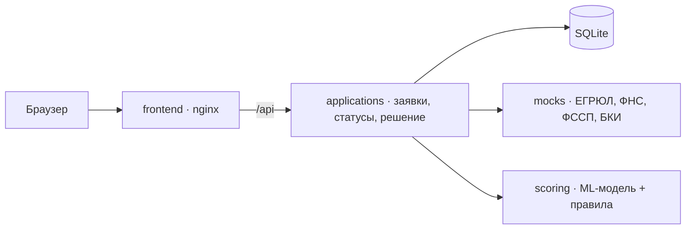

# Умный кредитный кабинет предпринимателя

Альфа-Будущее Хакатон 2026 · команда «Sanek».

Веб-кабинет, где малый бизнес (ИП и ООО) подбирает кредит **от задачи**, подаёт заявку по ИНН без ручного ввода реквизитов, видит статус как трекер доставки и получает не только «да / нет», а **контрпредложение**: банк подбирает сумму и срок, которые клиент потянет. С другой стороны — рабочее место сотрудника для ручной проверки сложных случаев.

Все данные синтетические, внешние источники (ЕГРЮЛ/ЕГРИП, ФНС, ФССП, БКИ) — локальные моки.

## Запуск

Нужен только Docker (Docker Desktop или Docker Engine с Compose v2), интернет — только для скачивания образов при первой сборке.

```bash
docker compose up --build
```

Открыть **http://localhost:8080**. Первая сборка занимает несколько минут (образ скоринга ставит pandas и scikit-learn).

| Роль | Логин | Пароль |
|---|---|---|
| Клиент | `client@demo.alfa.ru` | `alfa2026` |
| Сотрудник банка | `manager@demo.alfa.ru` | `alfa2026` |

Swagger сервиса заявок: http://localhost:8080/docs · OpenAPI: http://localhost:8080/openapi.json

Остановить: `docker compose down` (данные заявок сохраняются в томе `applications-data`; удалить вместе с данными — `docker compose down -v`).

## Сценарий проверки (5 минут)

1. Войти клиентом → «Подобрать кредит» → «Оборудование или ремонт» → «Вся сумма сразу» → 3 млн ₽ → 18 мес → без залога → «Оформить заявку».
2. Демо-компания **`990000000299 · ИП Зерно`** → «Всё верно» → «Продолжить» → оба согласия → «Отправить заявку».
3. Трекер сам переходит по статусам → «Нужны документы» → загрузить любой PDF.
4. **Контрпредложение: 2 млн ₽ на 18 мес** вместо 3 млн — с причиной и разбивкой балла. Принять → подписать → «Деньги зачислены».
5. Другие исходы — по таблице демо-компаний в [docs/test-scenarios.md](docs/test-scenarios.md): одобрение, ручная проверка сотрудником, отказ по баллам, стоп-фактор.

Автоматически весь список сценариев проверяет `python tests/e2e_scenarios.py http://localhost:8080` (нужен `pip install httpx`).

## Архитектура



| Компонент | Путь | Технологии |
|---|---|---|
| Кабинет клиента и сотрудника | `frontend/` | HTML/CSS/JS без сборки, nginx |
| Сервис заявок | `services/applications/` | Python 3.12, FastAPI, SQLite |
| Сервис скоринга | `services/scoring/` | FastAPI, scikit-learn; модель и признаки из `backend/fns_parser/scoring` |
| Моки внешних источников | `services/mocks/` | FastAPI, JSON-справочник синтетических компаний |
| Парсер реальных источников и анкета по дереву решений | `backend/` | FastAPI; профиль `real-sources`, в демо выключен |
| Обучение ML-модели | `ML/` (`train.py`, `label_rules.py`, `model_code.py`) | см. [ML/README.md](ML/README.md) |

Подробно: [docs/architecture.md](docs/architecture.md).

## Как принимается решение

1. **Стоп-факторы:** ликвидация или банкротство, бизнес младше 3 месяцев, долг у приставов > 1 млн ₽.
2. **Скоринг 0–100:** финансовая устойчивость по ML-модели (до 40), платёжная дисциплина по БКИ (20), нагрузка «платежи / выручка» (15), возраст бизнеса (10), налоговый долг (10), суды и приставы (5). Нет отчётности (ИП, молодой бизнес) — модель не применяется, остальные баллы масштабируются до 100.
3. **Кредитная логика:** < 35 — отказ; 35–49 — ручная проверка; ≥ 50 — проверка платежа (≤ 30 % выручки при балле ≥ 70, ≤ 20 % при 50–69) → одобрено или контрпредложение: сначала срок в пределах, названных клиентом, потом сумма.

ML-модель: логистическая регрессия на открытой бухотчётности (RFSD), 13 финансовых показателей + отрасль, 4 702 компании, ROC-AUC 0,87 на отложенной выборке; скор ≥ 0,78 — компания финансово устойчива. Подробности и ограничения — [ML/README.md](ML/README.md).

## Конфигурация

| Переменная | Сервис | По умолчанию | Назначение |
|---|---|---|---|
| `WEB_PORT` | frontend | `8080` | Порт кабинета на хосте |
| `DEMO_PASSWORD` | applications | `alfa2026` | Пароль демо-учёток (задаётся при первом старте базы) |
| `STEP_SECONDS` | applications | `2.5` | Пауза между автоматическими шагами статусов |
| `MOCKS_URL`, `SCORING_URL` | applications | адреса в сети compose | Адреса соседних сервисов |
| `DB_PATH`, `UPLOAD_DIR` | applications | `/data/...` | База и загруженные выписки (том `applications-data`) |
| `CORS_ORIGINS` | applications | пусто | Нужен только при запуске фронта отдельно от nginx |

Требования: Docker 24+ с Compose v2, 4 ГБ RAM, ~2 ГБ на образы; проверено на Python 3.12. Версии библиотек зафиксированы в `services/*/requirements.txt` и `backend/requirements*.txt`, базовые образы — с точными тегами.

## Документация для проверки

| Что | Где |
|---|---|
| Архитектурная схема | [docs/architecture.md](docs/architecture.md) |
| Диаграмма состояний заявки | [docs/state-diagram.md](docs/state-diagram.md) |
| Модель данных | [docs/data-model.md](docs/data-model.md) |
| OpenAPI / Swagger | [docs/openapi/](docs/openapi/) · http://localhost:8080/docs |
| Коллекция запросов | [docs/postman/alfa-credit-cabinet.postman_collection.json](docs/postman/alfa-credit-cabinet.postman_collection.json) |
| Тестовые сценарии и демо-данные | [docs/test-scenarios.md](docs/test-scenarios.md), `tests/e2e_scenarios.py` |
| Сторонние компоненты и моки | [THIRD_PARTY_NOTICES](THIRD_PARTY_NOTICES) |

## Границы MVP

Вошло: подбор от задачи (4 продукта), анкета по ИНН, согласия с журналом, трекер статусов, дозапрос документов, скоринг с ML-моделью, контрпредложение, ручная проверка сотрудником, имитация подписания и выдачи.

Не вошло и почему: полный каталог из 14 продуктов, лизинг, гарантии, факторинг — не меняют основной сценарий; самозанятые и физлица — другие продукты и процесс; реальное подписание и выдача — смоделированы по условиям кейса; LLM для разбора свободного описания цели — направление развития.
