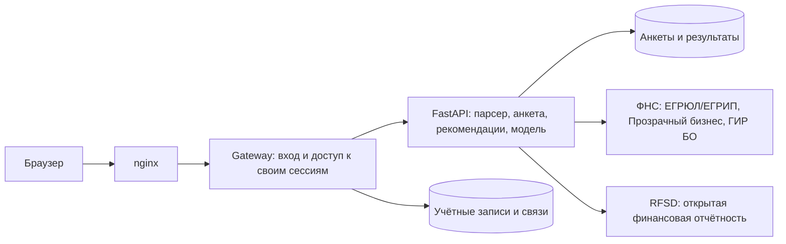

# Умный кредитный кабинет предпринимателя

Веб-кабинет для подбора финансирования малому бизнесу. Пользователь проходит анкету, указывает ИНН и получает рекомендации кредитных продуктов вместе с оценкой финансовой устойчивости компании. Сведения компании загружаются нашим парсером из реальных открытых источников.

Текущий результат — рекомендация. Банковское рассмотрение, подписание договора и выдача денег в этот сценарий не входят. Модель оценивает финансовую устойчивость; вероятность банковского одобрения пока не рассчитывается.

## Быстрый запуск

Нужны Git, Docker Desktop / Docker Engine с Compose v2 и доступ в интернет. Python и Node.js на компьютере для запуска через Docker не требуются.

```bash
git clone https://github.com/MaxEnergetic/alfa_case_championship_solution.git
cd alfa_case_championship_solution
docker compose up -d --build
```

| Что открыть | Адрес при стандартном запуске |
|---|---|
| Кабинет | [http://127.0.0.1:8080](http://127.0.0.1:8080) |
| Swagger API | [http://127.0.0.1:8080/docs](http://127.0.0.1:8080/docs) |
| Проверка доступности | [http://127.0.0.1:8080/health](http://127.0.0.1:8080/health) |

## Данные для входа

Учётная запись создаётся автоматически при первом запуске:

| Поле | Значение |
|---|---|
| Логин (email) | `user@local.test` |
| Пароль | `local-change-me` |

Это локальная учётная запись кабинета. Вход в ФНС, API-ключи и платные подписки не нужны.

### Свой порт и учётная запись

Скопируйте `.env.example` в `.env` в корне репозитория. Для запуска на порту **8081**, как в текущем локальном стенде, укажите:

```dotenv
WEB_PORT=8081
INITIAL_EMAIL=user@local.test
INITIAL_PASSWORD=local-change-me
```

После `docker compose up -d --build` кабинет будет доступен на [http://127.0.0.1:8081](http://127.0.0.1:8081), Swagger — на [http://127.0.0.1:8081/docs](http://127.0.0.1:8081/docs). Без `.env` используется порт **8080**. Публикация по умолчанию ограничена `127.0.0.1`.

Для своего входа задайте `INITIAL_EMAIL` и `INITIAL_PASSWORD` **до первого запуска**. Эти параметры создают пользователя, но не меняют пароль уже существующей учётной записи в сохранённой базе.

## Источники и сохранение данных

Для запросов к открытым источникам нужен интернет. Платных API и ключей нет. Если ФНС запросит капчу, введите её в кабинете: тот же запрос продолжится с сохранённой сессией источника. При ограничении доступа или недоступном источнике показывается ошибка/частичный результат, компания не генерируется.

Остановка: `docker compose down`. Именованные тома `accounts-data` и `parser-data` сохраняют учётные записи, анкеты, результаты и кеш. Не используйте `down -v`, если нужны сохранённые данные. Незавершённые фоновые задания живут в памяти одного процесса: после перезапуска парсера запрос нужно повторить; сохранённая анкета остаётся.

## Как пройти подбор

1. Войти с учётной записью выше и нажать «Новый подбор». Вопросы загружаются с бэкенда и зависят от предыдущих ответов.
2. Указать настоящий ИНН. Начнётся запрос выписки ЕГРЮЛ/ЕГРИП и «Прозрачного бизнеса», с дополнительным запросом ГИР БО. ИНН вводится один раз в анкете; справа можно обновить полученные сведения. API парсера также принимает ОГРН/ОГРНИП.
3. Если нужна капча — ввести её. При нескольких регистрациях выбрать нужный ОГРН. При конфликте сопоставимых полей подтверждённые сведения реестра имеют приоритет над ответами; конфликт виден в JSON.
4. Завершить анкету. При покупке имущества стоимость покупки и сумма кредита вводятся в одном блоке: это общая цена и её кредитная часть. Подбор вернёт кандидатов, запрос уточнения или отсутствие подходящих вариантов. Ставки и окончательные условия уточняются у банка.
5. После завершения анкеты открытые финансовые данные для юрлица загружаются автоматически. Один итоговый экран объединяет продукты и оценку модели; кнопка «Обновить оценку» повторяет расчёт. Это оценка класса финансовой устойчивости, а не вероятность возврата кредита. Для ИП модель не применяется.
6. Скачать общий JSON. Ответы можно исправлять: последующие вопросы перестраиваются, устаревшая оценка сбрасывается.

Для проверки загрузки открытых сведений можно использовать публичный ИНН **5505223431**. Введённые вами цель, сумма и другие ответы анкеты не являются подтверждёнными фактами об этой компании. Доступность источников и необходимость капчи зависят от ФНС.

### Что находится в результате

| Часть | Содержание |
|---|---|
| Рекомендации | Подходящие продукты и необходимые уточнения по ответам анкеты |
| Данные компании | Полученные сведения реестров, источники, даты и статусы загрузки |
| Финансовая оценка | Оценка модели по доступной отчётности, год и ограничения применимости |
| Общий JSON | Ответы пользователя, данные парсера, происхождение полей, конфликты и объединённый `assessment` |

Подтверждённые сведения реестров имеют приоритет над сопоставимыми ответами пользователя. Пропуски остаются неизвестными. `approval_probability.value` равен `null`, поскольку модель на фактических одобрениях и отказах банка пока отсутствует.

## Состав



`frontend/` — интерфейс; `services/applications/gateway.py` — авторизация; `backend/` — наш парсер, правила и модель; `ML/` — обучение модели. Моковые сервисы и искусственная формула баллов 0–100 удалены. БКИ и исполнительные производства в этом сценарии не проверяются: неизвестные сведения не подменяются нулевыми долгами.

## API и проверки

Swagger: http://127.0.0.1:8080/docs. Схема: [docs/openapi/applications.json](docs/openapi/applications.json). Примеры: [Postman](docs/postman/alfa-credit-cabinet.postman_collection.json).

```bash
cd backend
python -m unittest discover -s tests -q
cd ..
python services/applications/tests/test_gateway.py -q
node --check frontend/app.js
node --test frontend/app.test.cjs
```

Для тестов нужны зависимости `backend/requirements-scoring.txt`. Интеграционные тесты используют настоящие gateway и анкету, сетевые ответы заменяются только внутри тестов. Описание проверок: [docs/test-scenarios.md](docs/test-scenarios.md).

Ограничения модели и источников: [backend/README.md](backend/README.md), [ML/README.md](ML/README.md), [THIRD_PARTY_NOTICES](THIRD_PARTY_NOTICES). Модель не переобучалась в рамках переключения кабинета на реальные источники.

## Совместимость анкеты и восстановление

Новые сессии кабинета используют `flow_version=2`: стоимость покупки и кредитная часть вводятся одним блоком, сохраняются атомарно через `/answers/batch` и больше не спрашиваются отдельно. Сохранённые сессии первой версии поддерживаются без потери ответов. `assessment` объединяет подбор и финансовую оценку в JSON. `approval_probability.value=null`: имеющаяся модель не обучалась на фактических решениях банка. Сетевой сбой запускает сверку сохранённого состояния, а не повторную отправку ответа.

[Проверка соответствия кейсу](docs/case-audit.md): полное соответствие не подтверждено; в отчёте явно перечислены пробелы и изменения границ MVP по просьбе пользователя.
