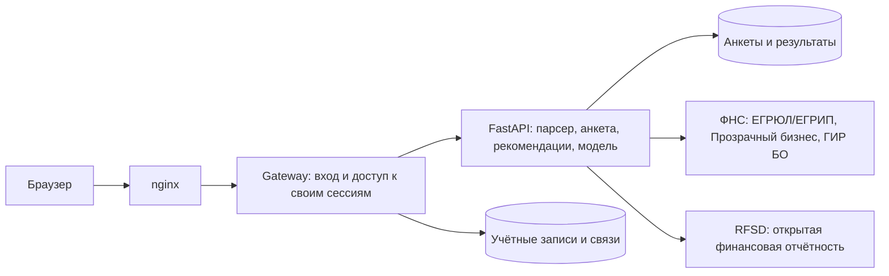

# Подбор финансирования для бизнеса

Для запуска нужны Docker Desktop / Docker Engine с Compose v2 и доступ в интернет.

Кабинет использует реальный парсер ФНС и исходное дерево анкеты из `backend/`. На выходе — рекомендации продуктов, подтверждённые сведения компании и отдельная оценка финансовой устойчивости по открытой отчётности. Нет банковского решения, подписания договора или выдачи денег.

## Запуск

```bash
docker compose up -d --build
```

Открыть http://127.0.0.1:8080. Локальный вход по умолчанию: `user@local.test` / `local-change-me`. Для своей учётной записи скопируйте `.env.example` в `.env` и задайте `INITIAL_EMAIL`, `INITIAL_PASSWORD` **до первого запуска**. Эти параметры создают пользователя, но не меняют пароль существующей учётной записи. Порт задаётся через `WEB_PORT`; публикация по умолчанию только на 127.0.0.1.

Для запросов к открытым источникам нужен интернет. Платных API и ключей нет. Если ФНС запросит капчу, введите её в кабинете: тот же запрос продолжится с сохранённой сессией источника. При ограничении доступа или недоступном источнике показывается ошибка/частичный результат, компания не генерируется.

Остановка: `docker compose down`. Именованные тома `accounts-data` и `parser-data` сохраняют учётные записи, анкеты, результаты и кеш. Не используйте `down -v`, если нужны сохранённые данные. Незавершённые фоновые задания живут в памяти одного процесса: после перезапуска парсера запрос нужно повторить; сохранённая анкета остаётся.

## Сценарий

1. Войти и начать подбор. Вопросы загружаются с бэкенда и зависят от предыдущих ответов.
2. Указать настоящий ИНН. Начнётся запрос выписки ЕГРЮЛ/ЕГРИП и «Прозрачного бизнеса», с дополнительным запросом ГИР БО. ИНН вводится один раз в анкете; справа можно обновить полученные сведения. API парсера также принимает ОГРН/ОГРНИП.
3. Если нужна капча — ввести её. При нескольких регистрациях выбрать нужный ОГРН. При конфликте сопоставимых полей подтверждённые сведения реестра имеют приоритет над ответами; конфликт виден в JSON.
4. Завершить анкету. Результат R01 — кандидаты, R02 — нужно уточнение, R03 — подтверждённых вариантов нет. Ставки и окончательные условия уточняются у банка.
5. После завершения анкеты открытые финансовые данные для юрлица загружаются автоматически. Один итоговый экран объединяет продукты и оценку модели; кнопка «Обновить оценку» повторяет расчёт. Это оценка класса финансовой устойчивости, а не вероятность возврата кредита. Для ИП модель не применяется.
6. Скачать общий JSON. Ответы можно исправлять: последующие вопросы перестраиваются, устаревшая оценка сбрасывается.

## Состав



`frontend/` — интерфейс; `services/applications/gateway.py` — авторизация; `backend/` — наш парсер, правила и модель; `ML/` — обучение модели. Моковые сервисы и искусственная формула баллов 0–100 удалены. БКИ и исполнительные производства в этом сценарии не проверяются: неизвестные сведения не подменяются нулевыми долгами.

## API и проверки

Swagger: http://127.0.0.1:8080/docs. Схема: [docs/openapi/applications.json](docs/openapi/applications.json). Примеры: [Postman](docs/postman/alfa-credit-cabinet.postman_collection.json).

```bash
cd backend
python -m unittest discover -s tests -q
cd ..
python services/applications/tests/test_gateway.py -q
node --check frontend/app.js
node --test frontend/app.test.cjs
```

Для тестов нужны зависимости `backend/requirements-scoring.txt`. Интеграционные тесты используют настоящие gateway и анкету, сетевые ответы заменяются только внутри тестов. Описание проверок: [docs/test-scenarios.md](docs/test-scenarios.md).

Ограничения модели и источников: [backend/README.md](backend/README.md), [ML/README.md](ML/README.md), [THIRD_PARTY_NOTICES](THIRD_PARTY_NOTICES). Модель не переобучалась в рамках переключения кабинета на реальные источники.

## Изменения анкеты

Новые сессии кабинета используют `flow_version=2`: стоимость покупки и кредитная часть вводятся одним блоком, сохраняются атомарно через `/answers/batch` и больше не спрашиваются отдельно. Сохранённые сессии первой версии поддерживаются без потери ответов. `assessment` объединяет подбор и финансовую оценку в JSON. `approval_probability.value=null`: имеющаяся модель не обучалась на фактических решениях банка. Сетевой сбой запускает сверку сохранённого состояния, а не повторную отправку ответа.

[Проверка соответствия кейсу](docs/case-audit.md): полное соответствие не подтверждено; в отчёте явно перечислены пробелы и изменения границ MVP по просьбе пользователя.
