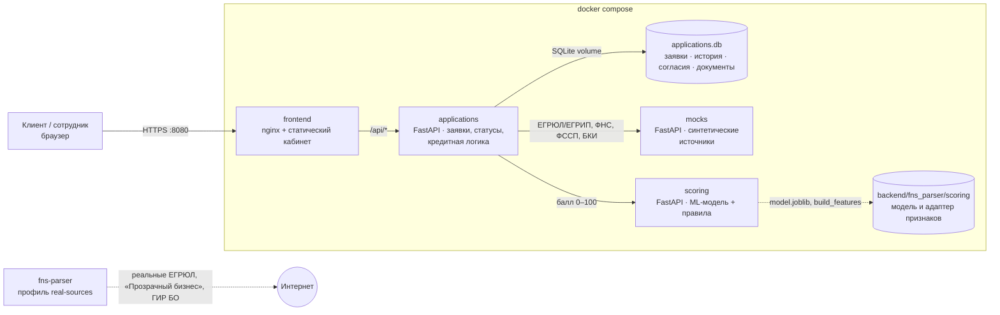
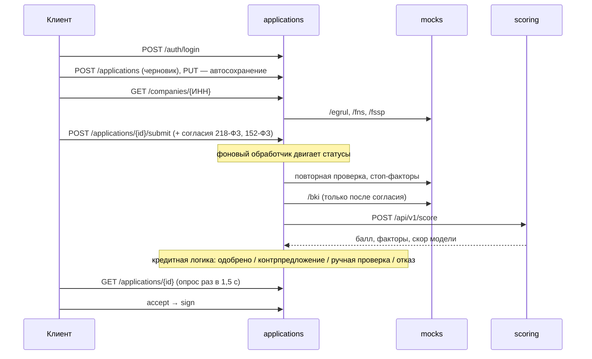

# Архитектура

Четыре контейнера в `docker-compose.yml` плюс выключенный по умолчанию адаптер реальных источников.

| Сервис | Что делает | Почему отдельно |
|---|---|---|
| `frontend` | Кабинет клиента и рабочее место сотрудника. nginx отдаёт статику и проксирует `/api` | Один origin, без CORS; заголовки безопасности (CSP, X-Frame-Options) |
| `applications` | Заявка как сущность: черновик, подача, переходы статусов, согласия, документы, решение, подписание | Владеет данными и процессом; единственная точка записи |
| `scoring` | Балл риска: ML-модель финансовой устойчивости (40 баллов) + правила (60) | Модель меняется независимо от процесса; тяжёлые зависимости (pandas, sklearn) только здесь |
| `mocks` | ЕГРЮЛ/ЕГРИП, ФНС («Прозрачный бизнес» + ГИР БО), ФССП/КАД, БКИ | По условиям кейса — без доступа к реальным системам; контракты упрощены, смысл сохранён |
| `fns-parser` (профиль) | Парсер реальных публичных источников из `backend/` | Показывает путь к продакшену; в демо выключен |

## Поток заявки

## Скоринг ≠ решение

`scoring` возвращает только оценку риска. Решение принимает `applications/decision.py`:

| Балл | Исход |
|---|---|
| < 35 | Отказ с причиной |
| 35–49 | Ручная проверка сотрудником |
| ≥ 50 | Проверка платежа. Допустимый платёж — 30 % месячной выручки при балле ≥ 70, 20 % при 50–69. Проходит → одобрено. Нет → контрпредложение: сначала срок (до максимума, который назвал клиент), затем сумма с шагом 100 тыс. ₽ |

Стоп-факторы до скоринга: ликвидация или банкротство, бизнес младше 3 месяцев, долг у приставов больше 1 млн ₽.

## Enterprise-аспекты

- **Безопасность.** Пароли — PBKDF2-SHA256 с солью; токены сессий хранятся только как SHA-256; роли `client` / `staff` проверяются на сервере (клиент не может принять решение за сотрудника — 403). Клиенту не отдаются сырые ответы БКИ. Загрузка: только PDF (проверка сигнатуры), до 10 МБ, сохраняется SHA-256 файла. CSP и X-Frame-Options на статике. Контейнеры запускаются не от root.
- **Надёжность.** Переходы статусов атомарные и условные (`UPDATE ... WHERE status = ожидаемый`), повторный клик или гонка не ломают заявку. Если `mocks` или `scoring` недоступны, шаг повторяется с экспоненциальной задержкой — заявка не теряется. SQLite в режиме WAL на томе `applications-data`.
- **Аудит.** Каждая смена статуса пишется в `status_history` (кто, когда, откуда, куда), согласия — в `consents` с автором и временем.
- **Масштабирование.** `scoring` и `mocks` без состояния — масштабируются репликами. `applications` для продакшена — PostgreSQL вместо SQLite и очередь (например, Kafka/RabbitMQ) вместо фонового цикла; контракты API при этом не меняются.
- **Сопровождение.** Версии зависимостей зафиксированы (`requirements.txt`, образы с точными тегами), у каждого сервиса `/health` и healthcheck в compose, OpenAPI в `docs/openapi/`.
