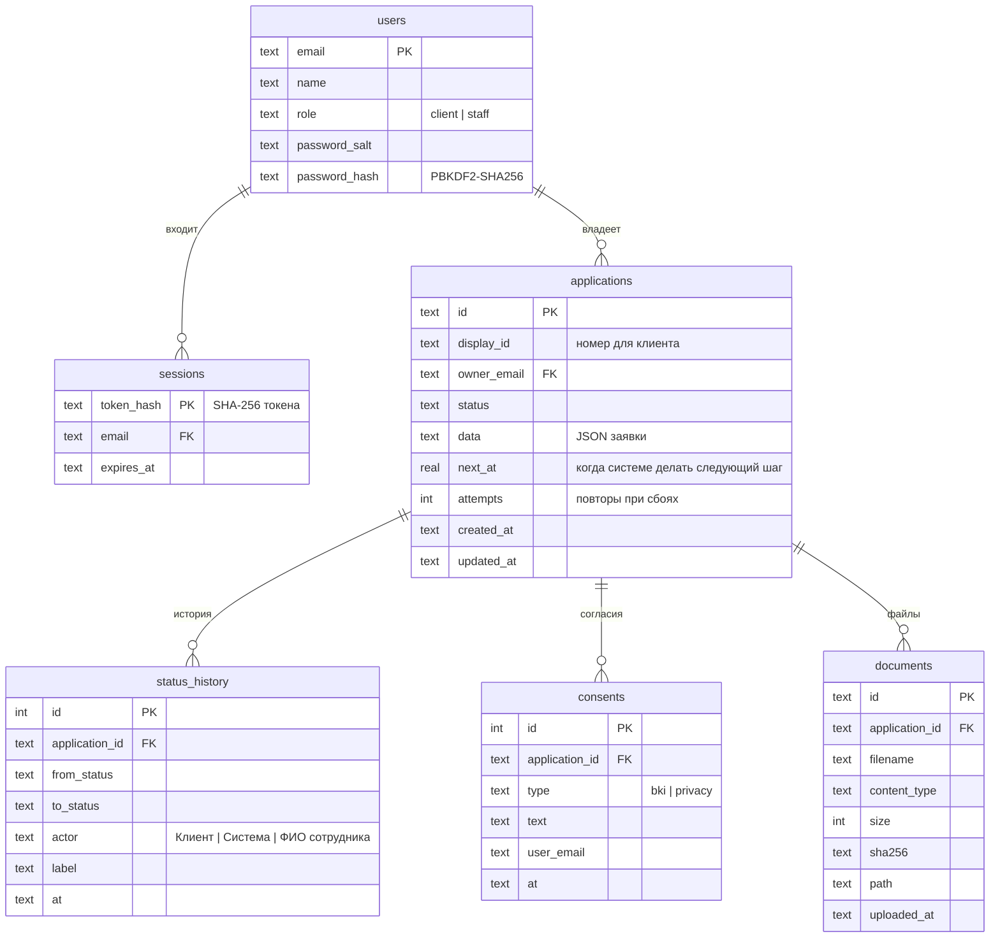

# Модель данных

SQLite (`/data/applications.db`, том `applications-data`). Схема создаётся при старте сервиса `applications` (`store.py`).

## `applications.data` (JSON)

| Поле | Содержимое | Источник |
|---|---|---|
| `form` | Ответы анкеты: цель, способ получения, сумма, срок, максимальный срок, залог, ИНН, заявитель, выручка, платежи, согласия | Клиент (автосохранение) |
| `wizardStage`, `wizardIndex` | Шаг анкеты, на котором остановился клиент | Клиент |
| `company` | Карточка компании в формате кабинета | ЕГРЮЛ/ЕГРИП + ФНС + ФССП (моки) |
| `product` | Выбранный продукт и ставка | Кредитная логика |
| `applicant` | Заявитель, роль, доверенность | Клиент |
| `enrichment` | Сырые ответы источников, включая БКИ (клиенту не отдаётся) | Моки |
| `decision` | Исход, сумма, срок, ставка, платёж, причина, балл с разбивкой по факторам, скор ML-модели | scoring + decision.py / сотрудник |
| `documentName`, `submittedAt`, `acceptedAt`, `signedAt`, `issuedAt` | Отметки процесса | Сервис |

Почему JSON-документ: анкета и ответы источников меняются чаще схемы; поля, по которым идёт выборка (статус, владелец, сроки), вынесены в колонки.
