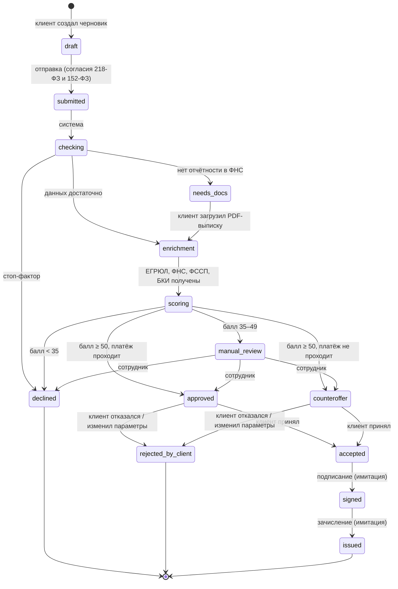

# Диаграмма состояний заявки

Статусы хранит сервис `applications` (поле `applications.status`), каждая смена пишется в `status_history`.

| Статус | Название в кабинете | Кто переводит дальше |
|---|---|---|
| `draft` | Черновик | Клиент |
| `submitted` | Подана | Система |
| `checking` | Проверяем данные | Система |
| `needs_docs` | Нужны документы | Клиент (загрузка PDF) |
| `enrichment` | Получаем сведения | Система |
| `scoring` | Оцениваем заявку | Система |
| `manual_review` | Ручная проверка | Сотрудник банка |
| `approved` / `counteroffer` | Одобрено / Контрпредложение | Клиент |
| `declined` | Отказ | — |
| `accepted` | Принято клиентом | Клиент (подписание) |
| `rejected_by_client` | Отклонено клиентом | — («Изменить параметры» создаёт новый черновик) |
| `signed` / `issued` | Договор подписан / Деньги зачислены | Система |

Шаги системы выполняет фоновый обработчик с паузой `STEP_SECONDS` (по умолчанию 2,5 с), чтобы в демо было видно движение статуса. При сбое соседнего сервиса шаг повторяется.
