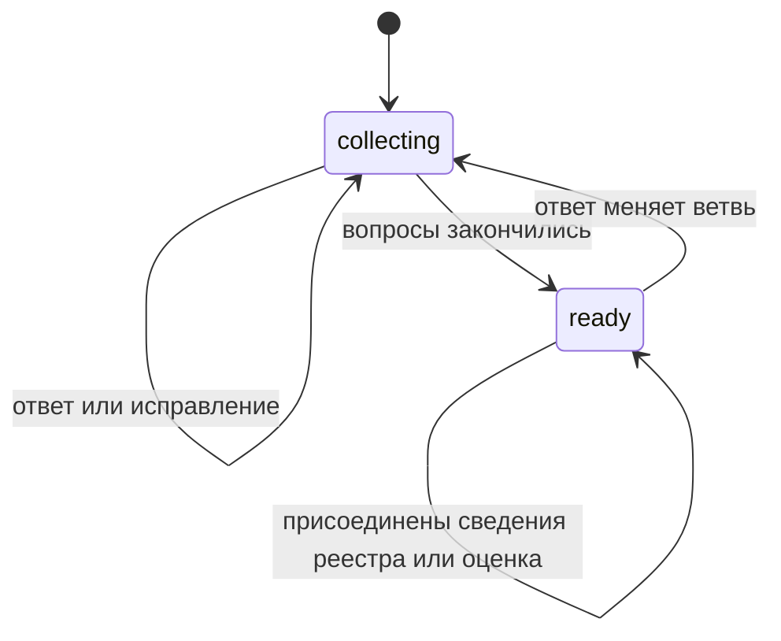
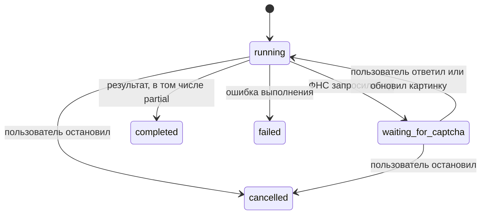

# Состояния

Результат `ready` содержит рекомендацию R01/R02/R03, а не банковское решение.

Истечение срока капчи может завершить источник с ошибкой и весь job с частичным результатом. `completed` само по себе не означает, что все источники доступны: проверяйте `result.status` и `result.sources`.
